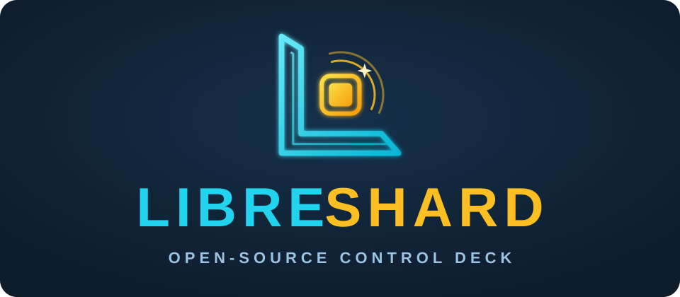
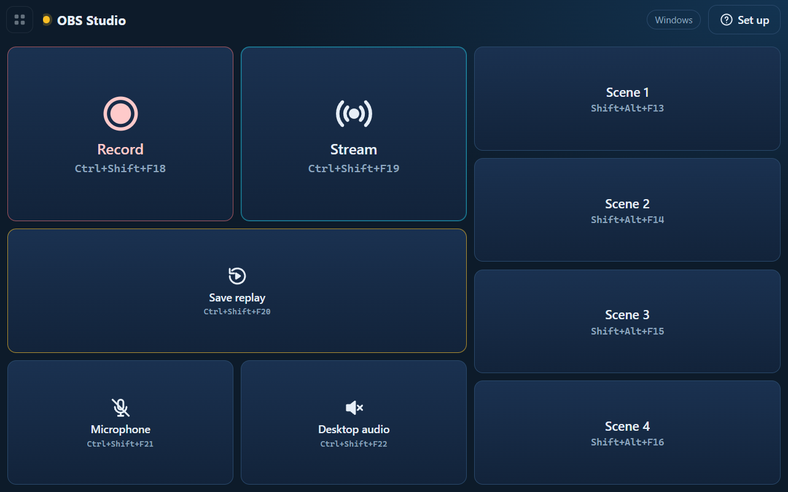
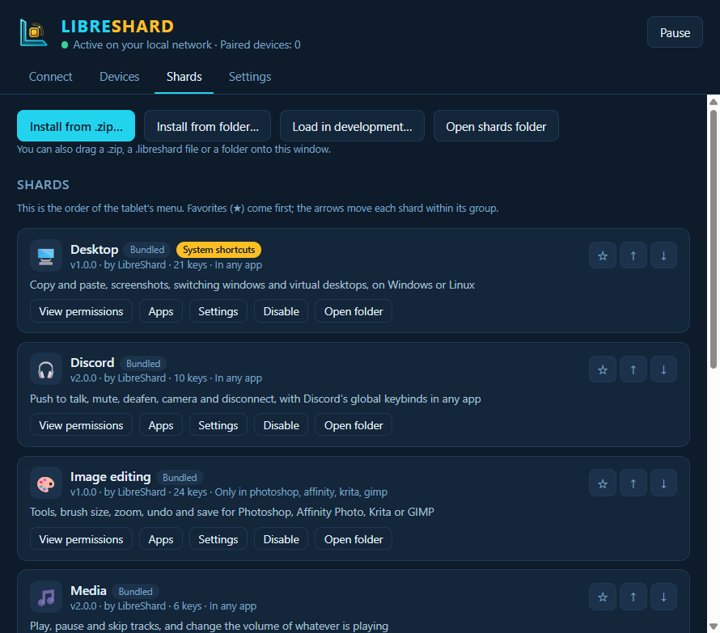
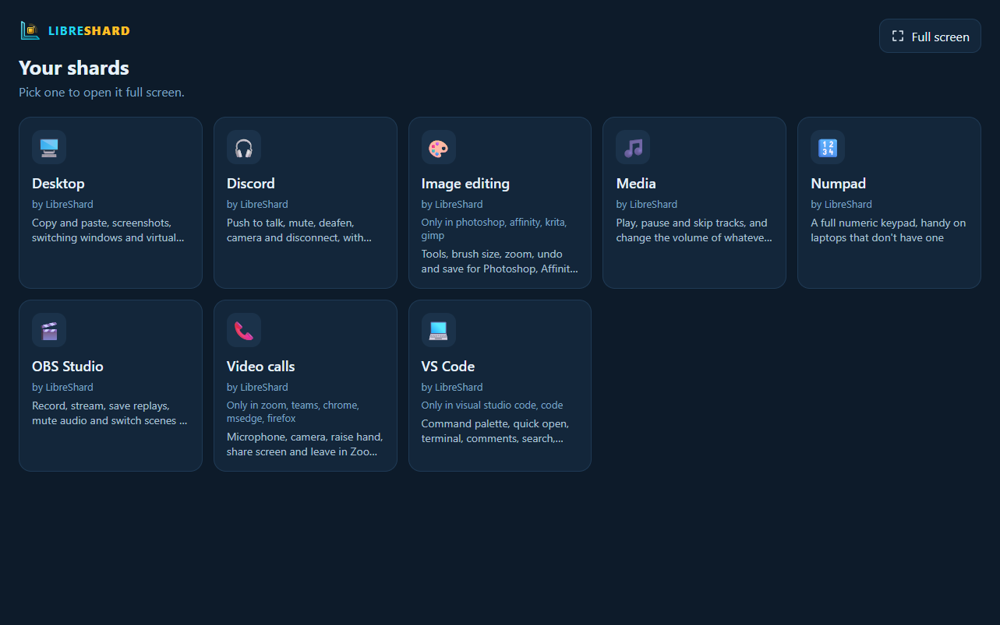

<p align="center">
  
</p>

<p align="center">
  <b>Tu hardware. Tus reglas.</b><br>
  El panel de control táctil de código abierto para creadores, jugadores y desarrolladores.
</p>

<p align="center">
  <a href="https://github.com/libreshard/libreshard/actions/workflows/ci.yml"></a>
  <a href="LICENSE"></a>
</p>

<p align="center"><a href="README.md">English</a> · <b>Español</b></p>

LibreShard convierte cualquier tablet, teléfono o pantalla que te sobre en un panel de control
táctil para tu PC, al estilo de un Stream Deck. No hay hardware que comprar ni nube: todo funciona
en tu red local, y los paneles (**shards**) son HTML, CSS y JavaScript que cualquiera puede escribir
y compartir.

<p align="center">
  <br>
  
  
</p>

## Características

- 🔓 **Sin depender de un fabricante.** Reutiliza una tablet vieja o el teléfono que ya tienes. No
  hay que instalarle nada: escaneas un QR y el panel se abre en el navegador.
- 🧩 **Shards.** Cada panel es una carpeta con una página web y un manifest. Instala uno soltando un
  zip en la ventana, crea el tuyo a partir de la [plantilla](docs/shard-template/) y mira cómo la
  tablet se recarga cada vez que guardas.
- 🛡️ **Seguro desde el diseño.** La tablet solo muestra páginas. La PC pulsa únicamente las teclas
  que un shard declaró **y** que tú aprobaste, tras una revisión que marca los atajos peligrosos. Los
  shards no pueden llegar a internet, a tus archivos ni a otros shards.
- 🎯 **Solo donde corresponde.** Limita un shard a las apps para las que está pensado, para que un
  toque nunca dispare un atajo en el programa equivocado.
- ⚡ **100 % local y privado.** Sin cuentas, sin telemetría: nada sale de tu red.
- 🌍 **Español e inglés**, según el idioma del sistema.

Shards incluidos: **Multimedia**, **Teclado numérico**, **Edición de imagen** (Photoshop, Affinity
Photo, Krita, GIMP), **Videollamadas** (Zoom, Teams, Meet), **Escritorio** (ventanas y escritorios
virtuales), **Discord**, **OBS Studio** y **VS Code**.

## Sistemas compatibles

| Sistema | Estado |
|---|---|
| Windows 10 y 11 | ✅ Compatible |
| Linux con X11 (o una sesión Xorg) | ✅ Compatible. Probado en Ubuntu 24.04 con GNOME y XFCE. |
| Linux con Wayland | ❌ No compatible: ahí no funcionan la simulación de teclas ni la detección de apps. |
| macOS | 🧪 Experimental: se compila, pero no se ha probado. |

En la tablet sirve cualquier navegador actual (Android, iPad, teléfonos u otro ordenador).

## Instalación

Descarga la última versión desde [Releases](https://github.com/libreshard/libreshard/releases).

### Windows

Ejecuta `LibreShard-Setup-<versión>.exe`. Se instala solo para tu usuario y no pide permisos de
administrador.

- **Firewall:** el instalador ofrece crear una regla del Firewall de Windows para que las tablets se
  conecten solo desde tu red **privada**. Aceptarla muestra un único aviso de administrador. Si dices
  que no, Windows te preguntará al abrir LibreShard por primera vez: permite solo **redes privadas**.
- **SmartScreen:** las versiones todavía no están firmadas (ver [Firma de código](#firma-de-código)),
  así que Windows puede decir "Windows protegió su PC". Pulsa **Más información → Ejecutar de todas
  formas**. Puedes comprobar la descarga con el archivo `SHA256SUMS.txt` de cada versión.
- **Juegos que se ejecutan como administrador:** ignoran las teclas de los programas normales. Para
  esos, ejecuta también LibreShard como administrador (lee la nota de
  [SECURITY.md](SECURITY.md#known-limitations)).

### Linux

- **Debian/Ubuntu:** `sudo apt install ./libreshard_<versión>_amd64.deb`. En Ubuntu 24.04 y
  posteriores el paquete instala además un perfil de AppArmor, que las apps de Electron necesitan ahí.
- **Otras distribuciones:** da permiso de ejecución a `LibreShard-<versión>.AppImage` y ábrelo. Los
  AppImage necesitan FUSE (`libfuse2` en la mayoría de distribuciones).
- **Paquetes:** `libxtst6` (simular teclas), `x11-utils` (detectar la app activa) y
  `x11-xserver-utils` (comprobar el mapa de teclado). El `.deb` los instala.
- **Firewall:** si tienes `ufw` activo, permite el puerto solo desde tu red local. Por ejemplo, si tu
  red es `192.168.1.x`:

  ```bash
  sudo ufw allow from 192.168.1.0/24 to any port 7878 proto tcp comment 'LibreShard'
  ```

  Usa el rango de tu red (lo muestra `ip -4 addr`) y tu puerto (7878, salvo que lo cambies en Ajustes).

### macOS (experimental)

Abre el `.dmg` y arrastra LibreShard a Aplicaciones. No está firmado: la primera vez, haz clic
derecho y elige **Abrir**. Necesita el permiso de **Accesibilidad** para pulsar teclas, y puede
necesitar **Grabación de pantalla** para detectar la app activa.

## Primeros pasos

1. Abre LibreShard en la PC. La pestaña **Conectar** muestra un código QR por cada red de la PC.
2. Escanea uno con la cámara de la tablet (el que se abra es el bueno), o abre la dirección en la
   tablet y escribe el código de 6 dígitos.
3. Elige un shard en el menú y a tocar. El botón flotante de la esquina superior izquierda cambia de
   shard y pone la pantalla completa.

Cada código sirve una vez y durante 10 minutos. Los dispositivos vinculados aparecen en la pestaña
**Dispositivos**, donde puedes renombrarlos o desvincularlos.

## Crea tu propio shard

Un shard es una carpeta con un `manifest.json`:

```json
{
  "id": "mi-panel-dev",
  "name": "Atajos de desarrollo",
  "author": "Tu nombre",
  "version": "1.0.0",
  "icon": "💻",
  "permissions": { "keys": ["ctrl+s", "ctrl+shift+p", "f5"] }
}
```

y un `index.html`:

```html
<button data-key="ctrl+s">Guardar</button>
<button data-key="ctrl+shift+p">Paleta de comandos</button>
<button data-key="f5">Depurar</button>
```

En la ventana de la PC, **Shards → Cargar en desarrollo…** enlaza tu carpeta: la tablet la recarga
cada vez que guardas. Para compartirlo, comprime la carpeta en un zip (o cambia la extensión a
`.libreshard`). Quien lo instale lo suelta en su ventana, después de revisar las teclas que pide.

La guía completa (teclas, ajustes, idiomas, limitar a apps, reglas de diseño) está en
**[docs/shards.md](docs/shards.md)** (en inglés).

## Seguridad y privacidad

- Cada tablet se vincula con un código temporal de un solo uso y recibe su propio token. La PC solo
  guarda su hash, y cada dispositivo se puede desvincular por separado. Los intentos fallidos tienen
  un límite.
- Por defecto, el servidor solo responde en redes privadas y rechaza las peticiones de páginas web
  abiertas en tu navegador.
- Los shards corren en un marco aislado sin acceso a la red, y solo pueden pulsar las teclas que
  aprobaste.
- El tráfico local va por HTTP sin cifrar: usa LibreShard en redes de confianza.

LibreShard no envía datos a ningún sitio. En **[SECURITY.md](SECURITY.md)** (en inglés) están el
modelo de amenazas, las limitaciones conocidas y cómo reportar una vulnerabilidad.

## Compilar desde el código

Necesitas [Node.js](https://nodejs.org/) 22 o posterior y Git.

```bash
git clone https://github.com/libreshard/libreshard.git
cd libreshard
npm install
npm start        # abre la app
npm test         # pasa las pruebas
npm run dist     # compila el instalador de este sistema en dist/
```

[CONTEXT.md](CONTEXT.md) explica la arquitectura, cada archivo y el protocolo.

## Contribuir

Se agradecen reportes de errores, shards, traducciones y código. Lee
**[CONTRIBUTING.md](CONTRIBUTING.md)**. Los commits deben llevar la firma del
[DCO](https://developercertificate.org/) (`git commit -s`).

Dónde hace falta ayuda: una galería comunitaria de shards, instalar shards desde una URL y datos en
vivo para los shards (volumen, CPU…) con permisos explícitos.

## Firma de código

Las versiones de Windows todavía no están firmadas. Tenemos previsto firmarlas gratis a través de
[SignPath Foundation](https://signpath.org/). Mientras tanto, comprueba las descargas con el archivo
`SHA256SUMS.txt` que acompaña a cada versión. Esta sección pasará a ser la política de firma de
código del proyecto cuando la firma esté en marcha.

## Licencia

LibreShard se distribuye bajo la **[Licencia Apache 2.0](LICENSE)**.

La plantilla de shards ([docs/shard-template/](docs/shard-template/)) y los archivos compartidos de
[shard-base/](shard-base/) están bajo **[MIT No Attribution](LICENSES/MIT-0.txt)**: puedes copiarlos
en tus shards sin incluir ningún aviso. Los shards que escribas son tuyos, con la licencia que elijas.

El nombre y el logo de LibreShard no están cubiertos por la licencia: ver
[TRADEMARKS.md](TRADEMARKS.md). Los demás nombres de productos pertenecen a sus dueños.
