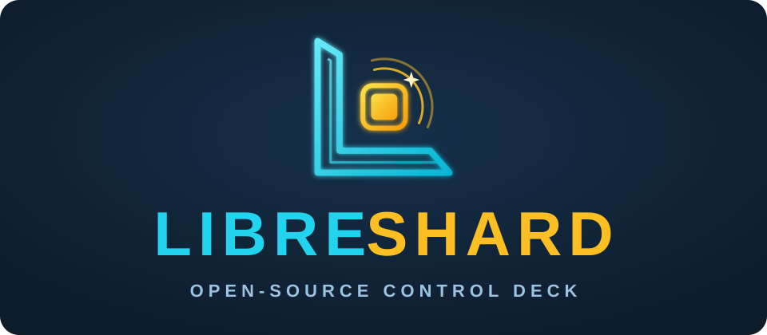
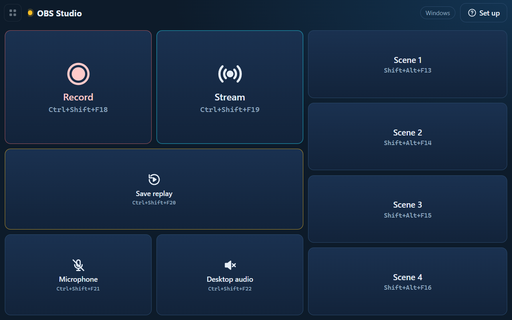
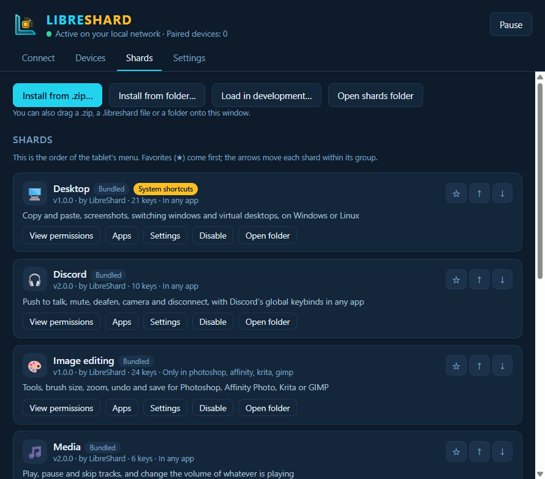
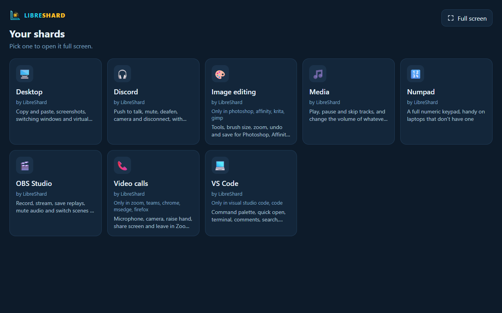
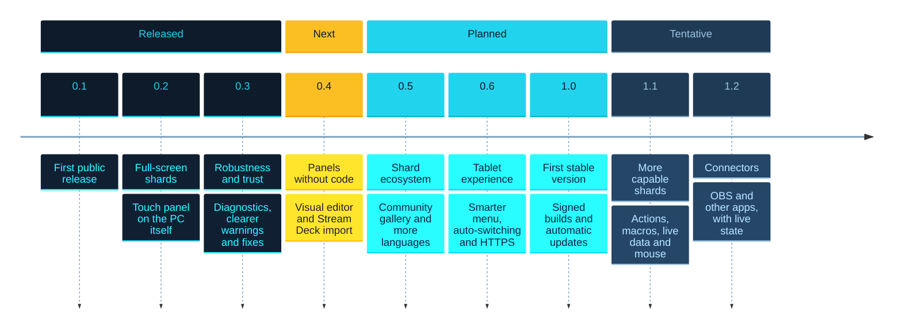

<p align="center">
  
</p>

<p align="center">
  <b>Your hardware. Your rules.</b><br>
  The open-source touch control deck for creators, gamers and developers.
</p>

<p align="center">
  <a href="https://github.com/libreshard/libreshard/actions/workflows/ci.yml"></a>
  <a href="LICENSE"></a>
</p>

<p align="center"><a href="https://libreshard.com"><b>libreshard.com</b></a></p>

<p align="center"><b>English</b> · <a href="README.es.md">Español</a></p>

LibreShard turns any tablet, phone or spare screen into a touch control panel for your PC, in the
spirit of a Stream Deck. There's no hardware to buy and no cloud: it runs entirely on your local
network, and the panels (**shards**) are plain HTML, CSS and JavaScript that anyone can write and
share.

<p align="center">
  <br>
  
  
</p>

## Features

- 🔓 **No vendor lock-in.** Reuse an old tablet or the phone you already have. Nothing to install on
  it: scan a QR and the panel opens in the browser.
- 🧩 **Shards.** Each panel is a folder with a web page and a manifest. Install one by dropping a zip
  on the window, build your own from the [template](docs/shard-template/), and watch the tablet
  reload as you save.
- 🛡️ **Safe by design.** The tablet only shows pages. The PC presses only the keys a shard declared
  **and** you approved, after a review that flags dangerous shortcuts. Shards can't reach the
  internet, your files or each other.
- 🎯 **Only where it belongs.** Limit a shard to the apps it's meant for, so a tap never fires a
  shortcut into the wrong program.
- ⚡ **Local and private.** No account, no telemetry. The only connection outside your network is a
  daily check for new versions, which sends nothing about you and can be turned off.
- 🌍 **English and Spanish**, following your system language.

Bundled shards: **Media**, **Numpad**, **Image editing** (Photoshop, Affinity Photo, Krita, GIMP),
**Video calls** (Zoom, Teams, Meet), **Desktop** (windows and virtual desktops), **Discord**,
**OBS Studio** and **VS Code**.

## Supported systems

| System | Status |
|---|---|
| Windows 10 and 11 | ✅ Supported |
| Linux with X11 (or an Xorg session) | ✅ Supported. Tested on Ubuntu 24.04 with GNOME and XFCE. |
| Linux with Wayland | ❌ Not supported: key simulation and app detection don't work there. |
| macOS | 🧪 Experimental: it builds, but isn't tested. |

The tablet side works in any modern browser (Android, iPad, phones, another computer).

## Install

Download the latest version from [libreshard.com](https://libreshard.com/download/) or from
[Releases](https://github.com/libreshard/libreshard/releases).

### Windows

Run `LibreShard-Setup-<version>.exe`. It installs for your user only and needs no administrator
rights.

- **Firewall:** the installer offers a Windows Firewall rule so tablets can connect from your
  **private** network only. Accepting it shows one administrator prompt. If you decline, Windows asks
  the first time you open LibreShard: allow **private networks** only.
- **SmartScreen:** releases aren't code-signed yet (see [Code signing](#code-signing)), so Windows
  may say "Windows protected your PC". Click **More info → Run anyway**. You can check the download
  against `SHA256SUMS.txt` in the release.
- **Games running as administrator** ignore keys from normal programs. The tablet tells you when
  that happens; run LibreShard as administrator too for those (read the note in
  [SECURITY.md](SECURITY.md#known-limitations)).

### Linux

- **Debian/Ubuntu:** `sudo apt install ./libreshard_<version>_amd64.deb`. On Ubuntu 24.04 and newer
  the package also installs an AppArmor profile, which Electron apps need there.
- **Other distributions:** make the `LibreShard-<version>.AppImage` executable and run it. AppImages
  need FUSE (`libfuse2` on most distributions).
- **Packages:** `libxtst6` (key simulation), `x11-utils` (app detection) and `x11-xserver-utils`
  (keyboard map checks). The `.deb` pulls them in.
- **Firewall:** if `ufw` is enabled, allow the port from your local network only. For example, if
  your network is `192.168.1.x`:

  ```bash
  sudo ufw allow from 192.168.1.0/24 to any port 7878 proto tcp comment 'LibreShard'
  ```

  Use your own network range (`ip -4 addr` shows it) and port (7878 unless you changed it in Settings).

### macOS (experimental)

Open the `.dmg` and drag LibreShard to Applications. It isn't signed: right-click it and choose
**Open** the first time. It needs the **Accessibility** permission to press keys, and may need
**Screen Recording** to detect the app in front.

## Quick start

1. Open LibreShard on the PC. The **Connect** tab shows a QR code for each network the PC is on.
2. Scan one with the tablet's camera (the one that opens is the right one), or open the address on
   the tablet and type the 6-digit code.
3. Pick a shard from the menu: it opens full screen (turn that off with the gear in the menu, per
   tablet). The floating button in the top-left corner switches shards and leaves or enters full
   screen.

Each code works once and for 10 minutes. Paired devices are listed in the **Devices** tab, where you
can rename or unpair them.

**Touch screen on the PC?** The **This PC** card next to the QR codes opens the shards in a window of
their own on this screen, no tablet needed. Tapping it never takes the focus from the app you are
controlling. Drag it to the touch monitor; it stays on top of other windows unless you turn off
"Keep this PC's panel on top" in Settings. On Linux it always stays on top and has its own bar to
move, resize and close it.

**New PC?** Settings → **Backup** saves your settings, app rules, shard order and settings, and the
shards you installed in one file. Importing it shows what would change first, and every shard goes
through the usual key review again. Paired tablets aren't included: pair them again.

## Make your own shard

A shard is a folder with a `manifest.json`:

```json
{
  "id": "my-dev-panel",
  "name": "Dev shortcuts",
  "author": "Your name",
  "version": "1.0.0",
  "icon": "💻",
  "permissions": { "keys": ["ctrl+s", "ctrl+shift+p", "f5"] }
}
```

and an `index.html`:

```html
<button data-key="ctrl+s">Save</button>
<button data-key="ctrl+shift+p">Command palette</button>
<button data-key="f5">Start debugging</button>
```

In the PC window, **Shards → Load in development…** links your folder: the tablet reloads it every
time you save. To share it, zip the folder (or rename the zip to `.libreshard`). People install it by
dropping it on their window, after reviewing the keys it asks for.

The full guide (keys, settings, languages, limiting to apps, design rules) is in
**[docs/shards.md](docs/shards.md)**.

## Security and privacy

- Each tablet pairs with a short-lived, single-use code and gets its own token; the PC stores only
  its hash, and any device can be unpaired on its own. Failed attempts are rate limited.
- The server only answers on private networks by default, and refuses requests from web pages open in
  your browser.
- Shards run in an isolated frame with no network access, and can only press keys you approved.
- Local traffic is plain HTTP, so use LibreShard on networks you trust.

LibreShard sends no data about you anywhere; its only outside connection is the check for new
versions (see [Privacy](SECURITY.md#privacy)). Read **[SECURITY.md](SECURITY.md)** for the threat
model, the known limitations and how to report a vulnerability.

## Build from source

You need [Node.js](https://nodejs.org/) 22 or newer and Git.

```bash
git clone https://github.com/libreshard/libreshard.git
cd libreshard
npm install
npm start        # run the app
npm test         # run the tests
npm run dist     # build the installer for this system into dist/
```

[CONTEXT.md](CONTEXT.md) explains the architecture, every file and the protocol.

## Roadmap



Versions and their contents can still change. 1.1 and 1.2 are tentative and will be evaluated after
1.0. The full list is in [CONTEXT.md](CONTEXT.md#9-roadmap).

## Contributing

Bug reports, shards, translations and code are welcome. See **[CONTRIBUTING.md](CONTRIBUTING.md)**.
Commits must be signed off (`git commit -s`, the [DCO](https://developercertificate.org/)).
Everyone taking part follows the [code of conduct](CODE_OF_CONDUCT.md).

Help is welcome on anything in the [roadmap](#roadmap).

## Code signing

Windows releases aren't code-signed yet. We plan to sign them for free through
[SignPath Foundation](https://signpath.org/) for 1.0, together with automatic updates. Until then,
check downloads against the `SHA256SUMS.txt` file published with each release. This section will
become the project's code signing policy once signing is in place.

## License

LibreShard is licensed under the **[Apache License 2.0](LICENSE)**.

The shard template ([docs/shard-template/](docs/shard-template/)) and the shared shard files in
[shard-base/](shard-base/) are under **[MIT No Attribution](LICENSES/MIT-0.txt)**, so you can copy
them into your own shards without any notice. Shards you write are yours, under the license you
choose.

The LibreShard name and logo aren't covered by the license: see [TRADEMARKS.md](TRADEMARKS.md).
Other product names belong to their owners.
